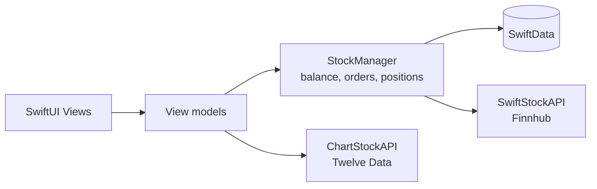

# Bajtlik – Paper-Trading App for iOS

Bajtlik is a SwiftUI app for learning to trade stocks without risking real money. You start with **$10,000 in virtual cash**, follow real companies with live market data, and place market or limit orders while the app tracks your portfolio and profit or loss.

*"Bajtlik" means "wallet" in the Silesian language.*

## Features

**Watchlist**
- Add any listed company by its ticker symbol; the app finds the best match and fetches its name and live quote.
- Pull to refresh prices, search saved stocks, and swipe to remove one.

**Stock details**
- Interactive price chart built with Swift Charts, with 1D, 7D, 1M, 6M and 1Y ranges.
- Current price, daily change, and the day's open, high and low.

**Trading**
- Buy and sell with **market orders** (filled at the live price) or **limit orders** (filled automatically once the price reaches your limit).
- Estimated cost and available cash are shown before you confirm, and orders are rejected if you lack the funds or shares.
- Cash for pending buy orders and shares for pending sell orders are reserved, so you can't spend or sell the same thing twice.

**Portfolio**
- Total portfolio value, unrealised profit or loss, and available cash.
- Pending limit orders, which you can cancel to release the reserved cash or shares.
- Pull to refresh prices; any limit orders whose price has been reached are executed at the same time.

**Settings**
- Dark mode, a reset of the virtual balance to $10,000, and About and Credits screens.

## Tech stack

| Area | Technology |
|---|---|
| Language and UI | Swift 5, SwiftUI |
| Persistence | SwiftData (positions, watchlist, limit orders); `UserDefaults` for the cash balance and settings |
| Charts | Swift Charts |
| Networking | `URLSession` with async/await |
| Market data | [Finnhub](https://finnhub.io) for quotes, search and company profiles; [Twelve Data](https://twelvedata.com) for price history |
| Testing | Swift Testing, XCTest and XCUITest |

## Architecture

The app follows **MVVM**. Views are kept free of business logic, view models prepare data for the screens, and a shared `StockManager` owns the account, the trading rules and the persistence.



```
Bajtlik_ios_trading/
├── Models/        PricePoint and chart time ranges
├── Services/      API clients, StockManager and the SwiftData models
├── ViewModels/    One view model per screen, plus chart logic
└── Views/         Watchlist, portfolio, trade, stock details, settings
```

## Testing

The project has **20 unit tests** and **5 UI tests**.

- **Unit tests** cover the chart view model, portfolio maths edge cases (no negative shares, no NaN values, zero cost basis), and the API clients. Network calls are intercepted with a `URLProtocol` stub, so the tests run offline and check parsing, error handling and concurrent requests.
- **UI tests** walk through launching the app, switching tabs, adding a stock and opening its details, placing a market buy, and resetting the balance.

Run them in Xcode with **⌘U**, or from the terminal:

```bash
xcodebuild test -project BajtlikTrade.xcodeproj -scheme Bajtlik_ios_trading \
  -destination 'platform=iOS Simulator,name=iPhone 17'
```

## Getting started

**Requirements:** Xcode 26 and an iOS 26 simulator or device.

1. Clone the repository and open `BajtlikTrade.xcodeproj`.
2. Get free API keys from [Finnhub](https://finnhub.io/register) and [Twelve Data](https://twelvedata.com/pricing).
3. Put the keys in `Services/SwiftStockAPI.swift` (Finnhub) and `Services/ChartStockAPI.swift` (Twelve Data).
4. Select the `Bajtlik_ios_trading` scheme and run with **⌘R**.

Free API plans have rate limits, so refreshing a long watchlist many times in a row may briefly return errors.

## Team

Built by **Miłosz Szynka**, **Katarzyna Michalska** and **Jakub Piskorowski** (Team Bajtlik).

## Disclaimer

Bajtlik is an educational project. All money in the app is virtual, and nothing in it is investment advice.
